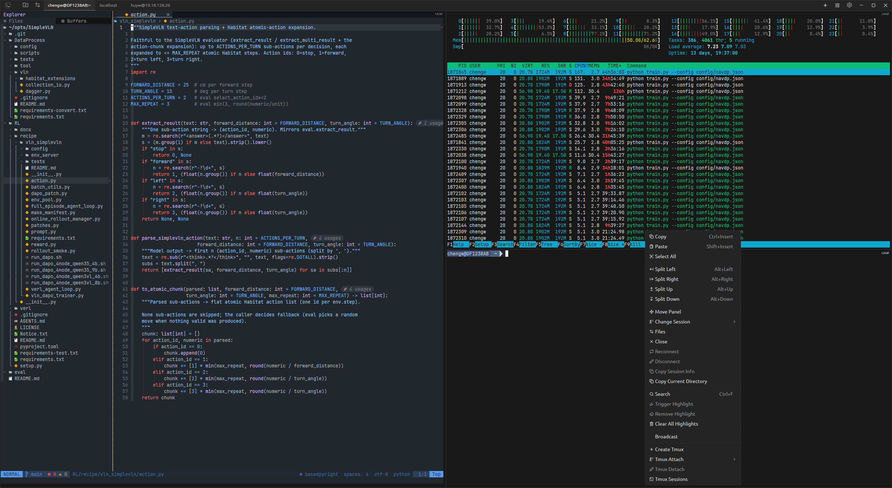
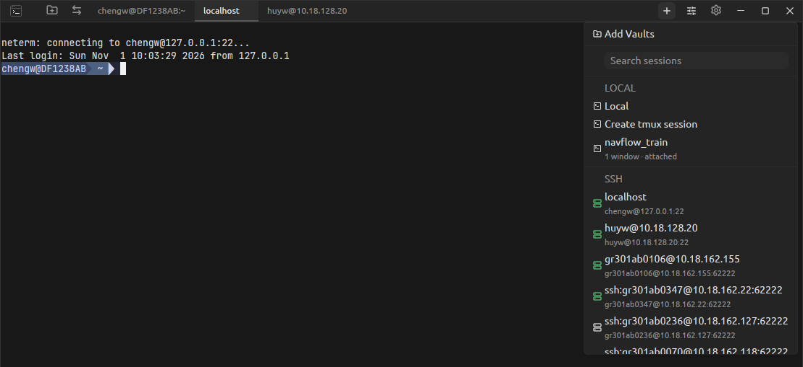
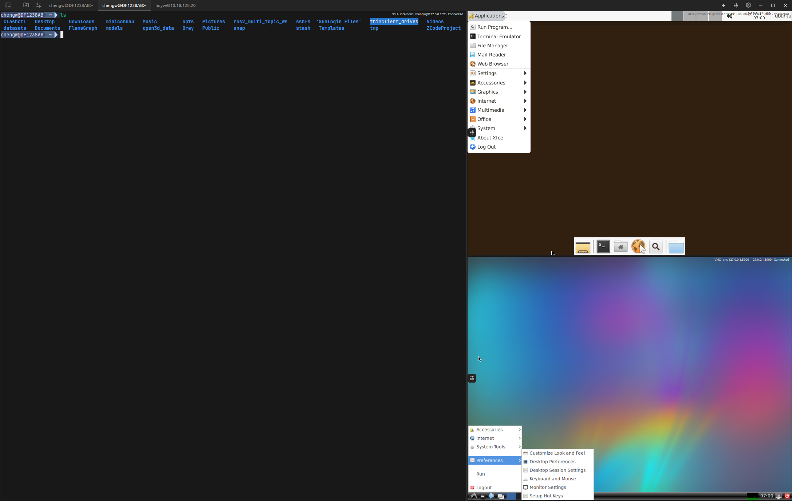
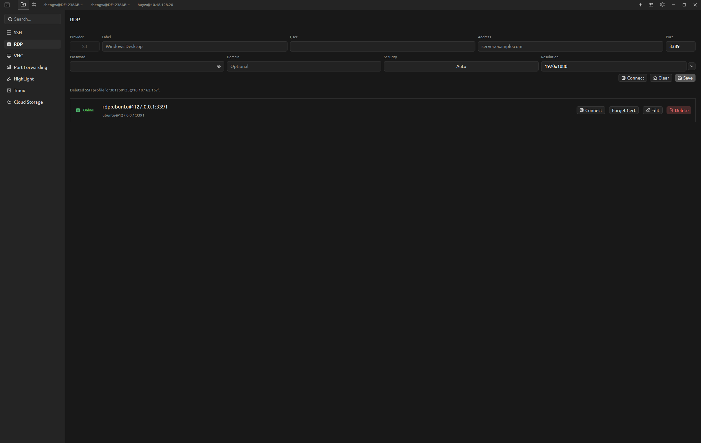
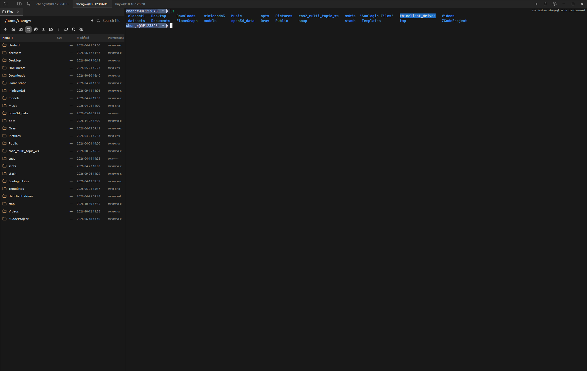
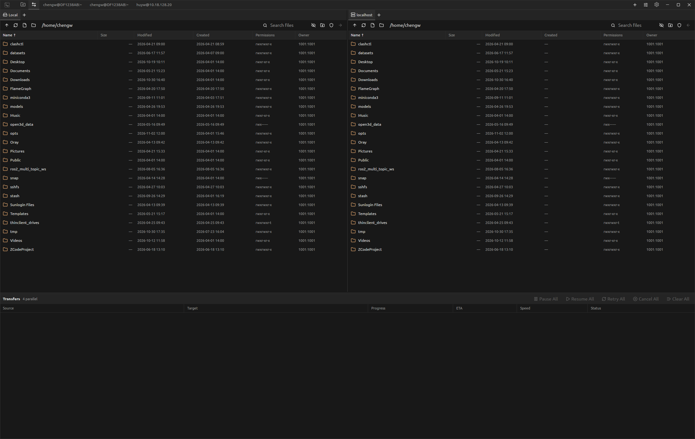
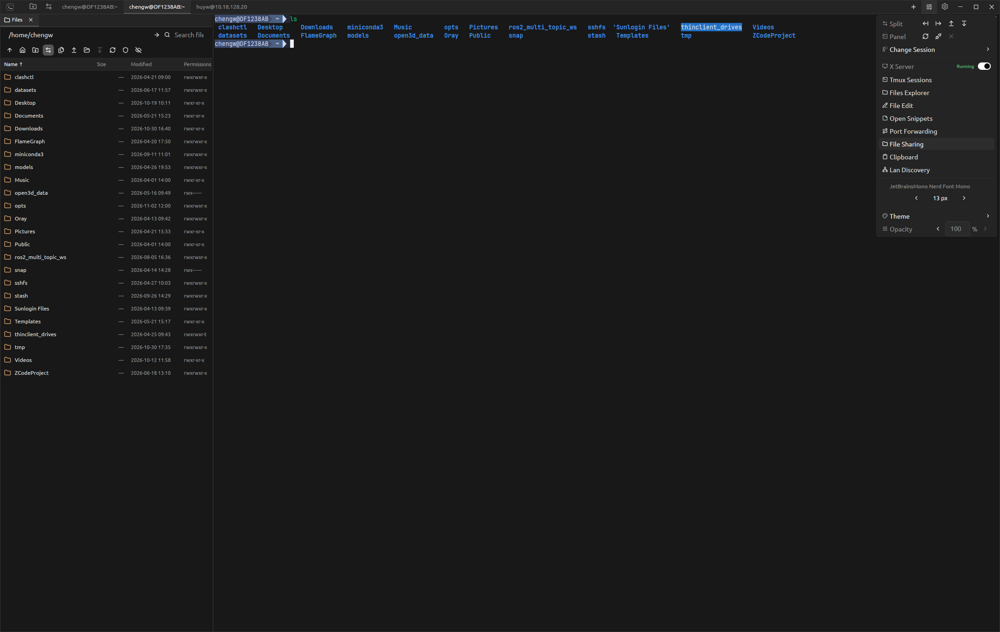
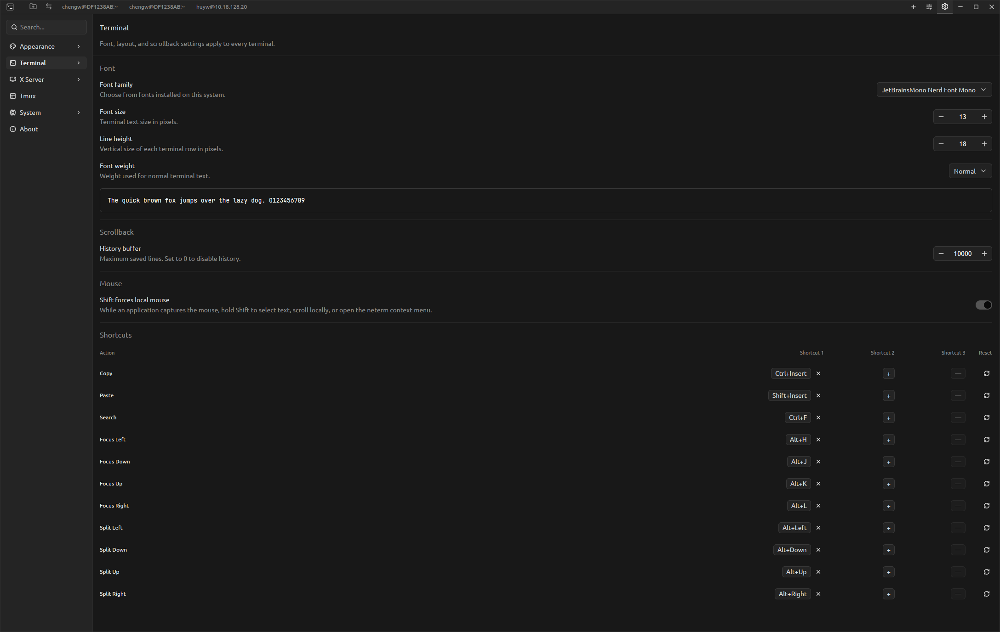

# neterm

neterm 是一个跨平台终端与远程工作空间。它把本地 Shell、SSH、tmux、RDP、VNC、SFTP、Cloud Storage、端口转发和文件工具整合在同一个窗口中，并提供可停靠工具面板、剪贴板历史、命令片段和局域网发现等辅助功能。

支持平台：

- Linux x86-64：`.deb`
- Windows x86-64：`.zip`
- macOS Apple Silicon：`.dmg`

[产品主页](https://rootec.pages.dev/neterm) · [下载 neterm](https://github.com/chengwei920412/neterm/releases)



## Workspace 与面板

顶部标签栏中的每个标签都是一个独立的 workspace。每个 workspace 保存自己的面板布局、激活面板和会话状态；标签过多时可以滚动查看，也可以拖动标签调整顺序。

点击标题栏的 **+** 按钮打开会话列表。列表按 Local、SSH、RDP、VNC 和 Cloud Storage 分类，并显示已保存远程配置的在线状态。可以在顶部搜索框中按名称快速过滤，也可以进入 Vaults 添加配置。



Workspace 支持以下操作：

- 右键 workspace 标签进行重命名、复制、关闭、关闭其他或关闭全部。
- 未重命名的标签会根据当前激活面板动态显示会话或命令名称；手动重命名后固定使用自定义名称。
- 右键面板选择 **Split Left / Right / Up / Down**，在对应方向创建面板。
- 拖动分隔线调整面板尺寸；进入 **Move Panel** 后可以预览并重新停靠面板。
- 使用 **Change Session** 在不改变布局的情况下切换 Local、SSH、RDP、VNC 或 Cloud Storage 会话。
- 开启 **Broadcast** 后，在一个终端输入的内容会同步发送给当前 workspace 内的其他终端面板。
- 使用快捷键在相邻面板之间切换焦点；到达布局边缘时不会循环。

Local、SSH、RDP 和 VNC 面板右上角会以透明文字显示会话信息和连接状态，当前激活面板使用更明显的文字颜色。终端面板断开后，按 Enter 或使用 **Reconnect** 可以重新连接。

### 终端右键菜单

终端右键菜单提供常用会话和文本操作：

- Copy、Paste、Select All
- Split、Move Panel、Change Session、Close
- Reconnect、Disconnect、Copy Session Info、Copy Current Directory
- Files：用当前会话和目录打开 Files Explorer
- Search：搜索终端历史，使用 Enter、Shift+Enter 或箭头切换匹配项
- Trigger Highlight、Remove Highlight、Clear All Highlights
- Create Tmux、Tmux Attach、Tmux Detach、Tmux Sessions

双击选择单词，三击选择整行。终端中的 TUI 应用可以直接接收鼠标事件；按住 Shift 可强制使用本地选择、滚动和右键菜单行为，该行为可以在 Settings > Terminal 中配置。

## 会话类型

### Local 与 SSH

Local 终端继承当前系统的 Shell 环境。macOS 从 Finder 启动时默认进入 Home 目录；分割出的新终端会继承原面板的当前目录。

Windows 的 Local 分类支持系统中可用的 PowerShell、WSL 和 Git Bash。SSH 支持密码、私钥、私钥密码、启动命令、Shell 选择、X11 转发和 tmux。

SSH 会临时安装 OSC 7 当前目录 hook，不修改远端配置文件。当前目录信息用于分割继承目录、Files Explorer 和复制当前目录；断开后可以使用相同配置无感重连。

### tmux 断连恢复

Linux、macOS 本地或 SSH 远端安装 tmux 3.2 及以上版本后，可以创建或连接 neterm 管理的 tmux 会话。

- tmux 只负责在断连后保持 Shell/TUI 进程；渲染、选择、鼠标、历史滚动和窗口大小仍由 neterm 管理。
- neterm 使用独立的 `tmux -L neterm -f /dev/null` server，不读取或修改用户已有的 tmux 配置和默认 server。
- 关闭 workspace、切换会话或 SSH 断开时会分离 control client；重新连接后恢复原会话内容。
- SSH profile 可以单独启用 Tmux，并与 Default、bash、zsh、fish 等 Shell 选择共同生效。
- **Tmux Sessions** 面板可以按 Local 或 SSH 上下文创建、刷新、附着、分离、重命名和删除会话。

### RDP 与 VNC

RDP 和 VNC 以普通面板形式打开，可以与终端混合分割和调整大小。远程画面保持宽高比，在面板内居中缩放，输入坐标会映射到远程分辨率。



RDP：

- 支持 Auto、TLS 和 NLA/CredSSP 安全协商，包括常见的 xrdp 登录。
- 支持预设或自定义分辨率，以及根据当前面板计算分辨率。
- 支持文本剪贴板同步和本地文件拖入。
- 证书使用首次信任（TOFU）。首次连接保存 SHA-256 指纹；证书变化时需要确认新指纹，或在 Vaults > RDP 中使用 **Forget Cert** 清除记录。

VNC：

- 支持 Encryption、Quality、View only 和 Shared 选项。
- 画面按面板尺寸等比例缩放，鼠标位置随缩放结果映射。
- VNC 剪贴板同步暂未启用。

## Vaults

Vaults 用于保存远程连接、转发配置和高亮规则。左侧搜索框可以过滤页面；SSH、RDP、VNC 和 Cloud Storage 列表中的状态图标可以点击刷新。



- **SSH**：保存 Label、User、Address、Port、Password、Key File、Key Passphrase、Shell、Forward X11、Tmux 和 Startup Command。
- **RDP**：保存用户、地址、端口、密码、域、安全模式和分辨率，并管理已信任证书。
- **VNC**：保存地址、密码、加密方式、画质、只读和共享会话选项。
- **Port Forwarding**：保存 Local、Remote 和 Dynamic 三种 SSH 端口转发。
- **HighLight**：管理跨面板共享的终端文本高亮规则；重复触发同一字符串会更换颜色。
- **Tmux**：选择 Local 或 SSH 主机，刷新和管理 neterm 专用 tmux server 中的会话。
- **Cloud Storage**：保存 S3 兼容服务的 Endpoint、Bucket、Region、Root、Access Key、Secret Key 和可选 Session Token。

保存后的 SSH、RDP、VNC 和 Cloud Storage profile 会出现在 Add Workspace、Change Session 和相关文件来源菜单中。密码、私钥密码和云端密钥写入用户私有配置，并从调试输出中脱敏。

## 文件管理与传输

neterm 提供三个互相配合的文件入口：

- **Files Explorer**：停靠在主界面左侧或右侧，适合围绕当前终端快速操作单个目录。
- **Files**：独立的双栏文件管理页面，适合跨 Local、SSH 和 Cloud Storage 复制文件。
- **File Edit**：打开 Local、SSH 或 Cloud Storage 文件，并支持双栏 Diff。

### Files Explorer

在 Quick Control 中选择 **Files Explorer**，或在终端右键菜单中选择 **Files**，可以打开单栏文件面板。通过终端打开时，neterm 会复用相同连接和路径的已有标签，避免重复创建。



Files Explorer 支持：

- 编辑路径、进入目录、返回上一级、回到 Home 和搜索当前目录。
- 显示或隐藏隐藏文件、刷新目录，并在 Local/SSH 环境中请求提升权限。
- 多选、新建文件、新建文件夹、重命名、删除和复制路径。
- Upload Files、Upload Folder、Download 和拖放传输。
- 在编辑器中打开文件，或将文件发送到双栏 Files 页面。
- 在面板底部显示当前文件传输进度。

### 双栏 Files

点击标题栏的双向箭头按钮打开双栏 Files 页面。左右栏都支持多个标签，可以打开 Local、SSH 或 Cloud Storage，并可将标签拖到另一侧。



- 文件表格显示 Name、Size、Modified、Created、Permissions 和 Owner，列宽可调整。
- 支持 Ctrl/Shift 多选、鼠标框选、拖放和方向按钮传输。
- 目录递归复制；目标存在时可以选择 Overwrite、Skip、Cancel、Overwrite all 或 Skip all。
- 搜索框按文件名过滤；文件列表获得焦点后连续输入前缀会跳转到匹配项。
- 右键菜单提供 New File、New Folder、Refresh、Copy Path、Rename、Delete、Upload、Download、Edit 和 Diff。
- 底部队列显示 Source、Target、Progress、ETA、Speed 和 Status；支持 Pause/Resume、Retry、Cancel、Remove，以及相应的批量操作。
- 重复任务不会被重复加入队列；任务完成后停止更新传输速度。

### 提升文件权限

路径工具栏中的盾牌按钮为当前标签授权受保护的文件操作：

- Linux Local 优先使用 `pkexec`，不可用时使用 neterm 密码框和 `sudo`。
- macOS Local 使用 `sudo`。
- Windows 暂不提供 Local 提权。
- SSH 通过远端 `sudo` 启动 OpenSSH `sftp-server`，远端必须安装对应程序，且 sudo 策略不能强制要求 TTY。

密码仅通过进程或 SSH 标准输入传递，使用后立即清除，不会保存。

## 文件编辑与 Diff

从文件菜单选择 **Edit**，或在 Quick Control 中打开 **File Edit**，可以编辑 Local、SSH 和 Cloud Storage 文件。

- 顶部可以选择文件来源、编辑完整路径、进入路径、选择文件、重新加载和保存。
- 双击路径输入框可以打开完整文件选择器；Windows 文件选择器会显示可用盘符。
- 编辑区支持垂直滚动；最大可打开文件大小由 Settings > System > File Editing 设置。
- 打开双栏后可以再次关闭右栏，或分别在左右两侧加载不同来源的文件。

使用文件右键菜单中的 **Diff Left** 和 **Diff Right** 可以直接比较两个文件。Diff 页面会对齐差异块、联动两侧滚动，并用整行背景和中间连接区域展示增删改关系。中间箭头可以把当前差异块从左侧应用到右侧，或从右侧应用到左侧；修改后分别保存对应文件。

## Quick Control 与工具面板

标题栏的 Quick Control 汇集当前面板操作和全局工具。



- **Split**：向左、右、上、下分割当前面板。
- **Panel**：重连、断开或关闭当前面板。
- **Change Session**：搜索并切换当前面板的会话。
- **X Server**：启动或停止本地 X Server。
- **Tmux Sessions**：打开当前 Local/SSH 上下文的 tmux 管理面板。
- **Files Explorer**：打开单栏文件面板。
- **File Edit**：打开文件编辑页面。
- **Open Snippets**：打开命令片段面板。
- **Port Forwarding**：管理已保存的端口转发并查看实时速率。
- **File Sharing**：通过 HTTP/FTP 分享本地目录。
- **Clipboard**：查看和搜索最近 50 条文本剪贴板历史。
- **Lan Discovery**：扫描局域网设备。
- **Theme、Opacity、Font**：快速调整主题、窗口透明度和终端字号。

Snippets、Port Forwarding、File Sharing、Clipboard、Tmux Sessions、Files Explorer 和 Lan Discovery 等工具可以同时打开。工具面板顶部以标签切换，支持重新排序、停靠到窗口左侧或右侧，并可以上下拆分。同一个工具再次打开时会聚焦已有标签。

### Snippets 与 Clipboard

Snippets 保存常用命令；双击条目会粘贴到当前终端。启用全局 **Auto Enter** 后，粘贴完成会自动发送回车。

Clipboard 自动记录最近 50 条文本。可以搜索、复制单条记录、双击恢复为当前剪贴板，或清空历史。

### Port Forwarding

端口转发基于已保存的 SSH profile：

- Local：把本地端口转发到远端可访问的目标。
- Remote：把远端端口转发到本地目标。
- Dynamic：在本地开启 SOCKS5 代理。

面板可以启动、停止全部转发，单独切换一条转发，并显示成功、失败、关闭状态及上下行速率。Vaults 中的配置变化会立即反映到面板。

### File Sharing

File Sharing 把多个本地目录通过 HTTP 和 FTP 分享到局域网：

- 可以设置 User、Password、HTTP/FTP 端口和 FTP 被动端口范围。
- **Allow editing** 控制客户端是否可以上传、重命名、新建和删除。
- 启动前会检查目录权限；需要时按平台请求提升权限。
- HTTP 页面内置在 neterm 中，提供上传、创建目录、重命名和删除。
- 面板显示可复制的访问地址、实时上下行速率，以及带本地日期时间的传输记录。

HTTP 和 FTP 均不加密，请仅在可信网络中使用。文件夹、编辑权限、用户名和端口会保存；密码和运行状态不会保存。

### Lan Discovery

Lan Discovery 扫描当前局域网中的可达设备，并显示 IP、MAC、主机名、厂商和发现来源等信息。面板支持搜索、刷新、取消扫描、复制设备信息和滚动查看结果；第二行显示已扫描地址和已发现设备的统计。

设备或系统没有公开名称服务时，用户名和设备名称可能显示为 Unknown；这不影响 IP/MAC 探测结果。

## X Server 与 SSH X11

Quick Control 中的 X Server 开关默认启用。Settings > X Server 用于设置本地 X display、服务器程序、启动参数、授权文件和测试连接。

- SSH profile 默认启用 Forward X11。
- X Server 启动或配置变化后，已连接的 SSH panel 会更新 `DISPLAY`；新建和重连会话自动使用最新设置，无需手动 export。
- Windows 可以配置 VcXsrv 等外部 X Server；Linux 和 macOS 根据当前环境使用配置的显示地址。
- `xcalc` 等普通 X11 应用可以通过转发显示。依赖硬件 GLX 的应用是否可用取决于本地 X Server 和远端 OpenGL 驱动，不能保证所有 OpenGL 程序正常运行。

## 设置

点击标题栏齿轮按钮打开 Settings。



### Appearance

- 内置 Graphite、Midnight、Forest、Plum 四套深色主题，以及 Pearl、Sand、Sky、Mint 四套浅色主题。
- Custom colors 可以调整窗口、标题栏、面板、边框、强调色、文字、选区和终端颜色。
- ANSI colors 可以自定义终端 16 色调色板。

外观修改立即应用到当前窗口。

### Terminal

- Font family、Font size、Line height 和 Font weight。
- History buffer 控制终端回滚行数。
- Shift forces local mouse 控制 TUI 捕获鼠标时的本地强制操作。
- Shortcuts 以表格展示，每个动作最多配置三个候选快捷键，并可逐行恢复默认。

默认快捷键：

| 动作 | Linux / Windows | macOS |
| --- | --- | --- |
| Copy | Ctrl+Insert | Ctrl+Backspace、Command+C |
| Paste | Shift+Insert | Shift+Backspace、Command+V |
| Search | Ctrl+F | Command+F、Ctrl+F |
| Focus Left/Down/Up/Right | Alt+H/J/K/L | Command+H/J/K/L |

Ctrl+J、Tab 等未配置为应用快捷键的按键会发送给当前 Shell 或 TUI。

### X Server、Tmux 与 System

- **X Server**：本地 X Server 地址、程序、参数、授权和连接测试。
- **Tmux**：统一配置 Local 和 SSH tmux 行为，包括隐藏状态栏等选项。
- **System > Startup**：控制启动时是否最大化窗口。
- **System > File Transfer**：设置并行传输数量。
- **System > File Editing**：设置允许打开的最大文件大小。
- **System > Remote Connection Status**：启用在线检测、交互时刷新、自动刷新间隔、超时和最大并行检查数，并可手动刷新全部状态。

### About

About 显示应用 Logo、联系邮箱、当前渲染后端、日期时间、Machine ID 和许可证状态。

## 许可证

未激活时：

- 最多同时打开 5 个 workspace 标签，包括初始 Local 标签。
- 最多同时运行 2 个端口转发，保存配置数量不限。
- RDP、VNC 和 Cloud Storage 各最多同时保持 1 个连接。

激活步骤：

1. 在 Settings > About 复制 Machine ID 并发送给授权方。
2. 把收到的许可证粘贴到 About 的许可证输入框。
3. 点击 **Activate**。

许可证与机器绑定，并按 UTC 时间判断有效期。许可证过期不会立即关闭已存在的会话，但会阻止继续创建超出限制的新会话。

## 数据存储

设置、Vaults、Snippets、剪贴板历史、文件共享配置、RDP 证书信任和许可证保存在用户配置目录：

- Linux：`$XDG_CONFIG_HOME/neterm/neterm.json`，默认 `~/.config/neterm/neterm.json`
- macOS：`~/Library/Application Support/neterm/neterm.json`
- Windows：`%APPDATA%\neterm\neterm.json`

## 常见问题

### Linux 启动崩溃或窗口不显示

neterm 默认请求 Vulkan 硬件渲染。请先确认 GPU 设备节点、Vulkan loader 和显卡驱动可用。无可用 Vulkan GPU 时，可以安装发行版提供的 Mesa Lavapipe，然后使用软件渲染启动：

```sh
NETERM_SOFTWARE_RENDERING=1 neterm
```

软件渲染时出现 EGL DRI2 警告不一定代表启动失败；只要窗口能够正常显示即可。

### macOS 提示应用损坏或无法验证开发者

DMG 中的 `neterm.app` 使用 ad-hoc 签名，尚未经过 Apple 公证。首次运行可以在 Finder 中右键应用并选择“打开”，或在“系统设置 > 隐私与安全性”中允许运行。

### Windows 提示未知发布者

Windows 版本尚未进行代码签名，SmartScreen 可能显示警告。确认安装包来自官方 Release 后选择“仍要运行”。

### 终端颜色、补全或鼠标行为异常

Local 终端使用 `TERM=xterm-256color` 和 `COLORTERM=truecolor`，并清除从父终端继承的 Ghostty、Kitty、WezTerm 等 Shell 集成变量。TUI 捕获鼠标时按住 Shift 可以临时使用 neterm 的本地选择、滚动和右键行为。
